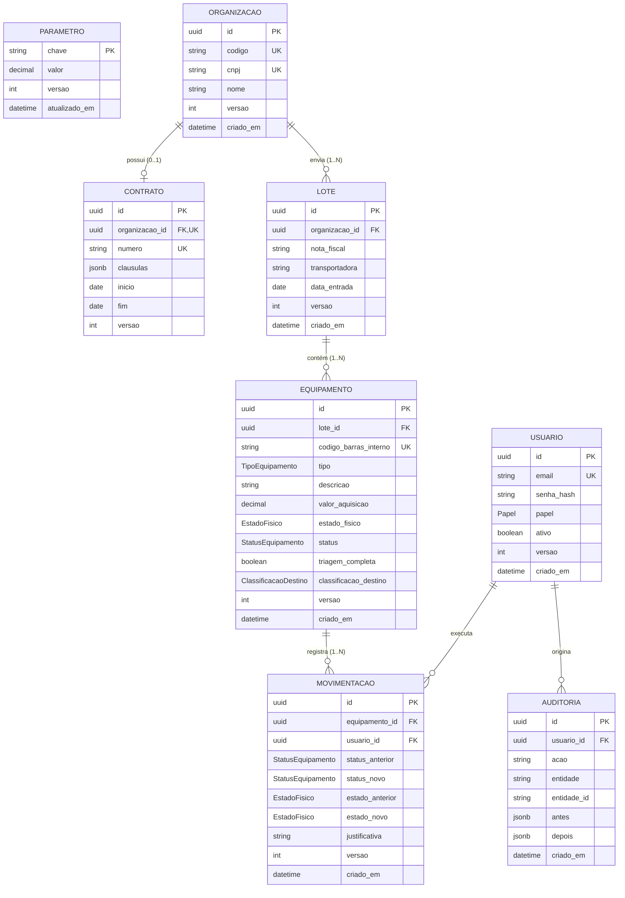
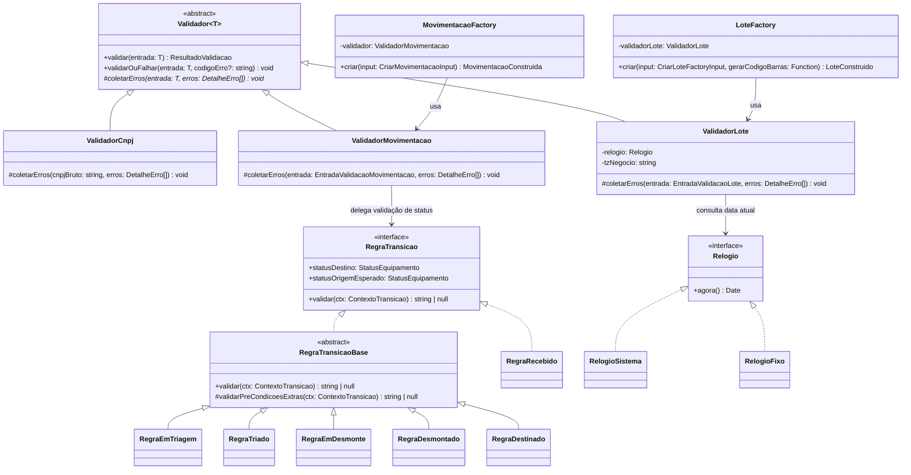
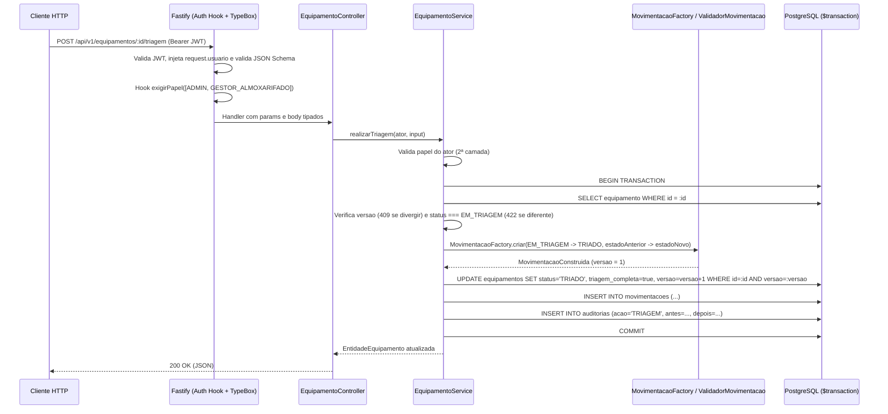

# ARQUITETURA DO SISTEMA — greencode

Este documento descreve a arquitetura em camadas, o modelo entidade-relacionamento, o diagrama de classes UML do domínio implementado, o fluxo de requisição, o mapeamento de comandos da AV1 para rotas REST da AV2, a matriz de permissões por rota e o uso intencional de `select`/`include` no Prisma.

---

## 1. Diagrama de Camadas

O sistema segue estritamente a separação **Controller → Service → Repository**, apoiada pelo núcleo puro de **Domain** (`src/domain/`):

- **Controllers (`*.controller.ts`):** tratam apenas protocolo HTTP (extração de parâmetros já validados por JSON Schema TypeBox, invocação do Service e retorno de código HTTP).
- **Services (`*.service.ts`):** concentram toda a regra de negócio, autorização em segunda camada (defesa em profundidade) e coordenação de transações via interface `GerenciadorTransacao`. **Não importam Fastify nem Prisma Client.**
- **Repositories (`*.repository.ts`):** único ponto de contato com o `PrismaClient`, oferecendo também implementações em memória (`Memoria*Repository`) para testes unitários rápidos de Service.
- **Domain (`src/domain/`):** classes abstratas de validação (`Validador<T>`), fábricas (`LoteFactory`, `MovimentacaoFactory`), polimorfismo de transição (`RegraTransicao`), relógio injetável (`Relogio`) e hierarquia de erros de negócio.

```mermaid
flowchart TD
    Cliente["Cliente HTTP / SPA / Script Jornada"]
    Fastify["Fastify App (Hooks: CORS, Helmet, Rate Limit, JWT Auth, Error Handler)"]
    Controller["Controllers & JSON Schemas (TypeBox)"]
    Service["Services (Regras R1-R12, RBAC, Transações)"]
    Domain["Domínio Puro (Validador<T>, RegraTransicao, Factories, Relogio)"]
    RepoInterface["Interfaces de Repositório (*Repository)"]
    PrismaRepo["Implementação Prisma (Prisma*Repository)"]
    MemRepo["Implementação em Memória (Memoria*Repository - Testes Unitários)"]
    Postgres[("PostgreSQL 16 (Tabelas, CHECKs, Triggers, Sequence)")]

    Cliente --> Fastify
    Fastify --> Controller
    Controller --> Service
    Service --> Domain
    Service --> RepoInterface
    RepoInterface <|.. PrismaRepo
    RepoInterface <|.. MemRepo
    PrismaRepo --> Postgres
```

---

## 2. Diagrama Entidade-Relacionamento (ER)



---

## 3. Diagrama UML do Domínio Implementado (`src/domain/`)

> Conforme decisão **D-C5**, o diagrama UML original da AV1 não foi fornecido; o diagrama abaixo reflete fielmente as classes, interfaces e relações implementadas em `src/domain/`.



---

## 4. Fluxo de uma Requisição (do Cliente ao Banco)

Exemplo: `POST /api/v1/equipamentos/:id/triagem`



---

## 5. Mapeamento: Comando CLI da AV1 → Rota REST da AV2 (`A1-20`)

| Comando na CLI Original (AV1) | Método e Rota REST na AV2 | Corpo / Query Principal |
|---|---|---|
| `provisionar --email ... --senha ...` | Script `npm run criar-admin` | Variáveis `ADMIN_EMAIL` / `ADMIN_SENHA` |
| `login --email ... --senha ...` | `POST /api/v1/auth/login` | `{ email, senha }` |
| `sessao renovar` | `POST /api/v1/auth/renovar` | Header `Authorization: Bearer <token>` |
| `menu` / `whoami` | `GET /api/v1/auth/me` | Devolve `{ id, email, papel, permissoes[] }` |
| `usuario criar --email ... --papel ...` | `POST /api/v1/usuarios` | `{ email, senha, papel, ativo? }` |
| `usuario listar` | `GET /api/v1/usuarios` | `?pagina=1&tamanhoPagina=20` |
| `usuario atualizar --id ... --ativo ...` | `PATCH /api/v1/usuarios/:id` | `{ versao, email?, senha?, papel?, ativo? }` |
| `parametro listar` | `GET /api/v1/parametros` | — |
| `parametro definir --chave ... --valor ...` | `PUT /api/v1/parametros/:chave` | `{ valor, versao? }` |
| `org criar --codigo BR001 --cnpj ... --nome ...` | `POST /api/v1/organizacoes` | `{ codigo, cnpj, nome }` |
| `org listar` | `GET /api/v1/organizacoes` | `?pagina=1&tamanhoPagina=20` |
| `org atualizar --id ... --nome ...` | `PATCH /api/v1/organizacoes/:id` | `{ versao, codigo?, cnpj?, nome? }` |
| `contrato criar --org ... --numero ...` | `POST /api/v1/organizacoes/:id/contrato` | `{ numero, clausulas?, inicio, fim? }` |
| `contrato atualizar --org ...` | `PATCH /api/v1/organizacoes/:id/contrato` | `{ versao, numero?, clausulas?, inicio?, fim? }` |
| `lote criar --org BR001 --nf 123456 --transp TransRapida` | `POST /api/v1/lotes` | `{ orgCodigo, notaFiscal, transportadora, dataEntrada, equipamentos[] }` |
| `equipamento criar --lote ... --tipo ...` | `POST /api/v1/equipamentos` | `{ loteId, tipo, descricao, estadoFisico, valorAquisicao?, codigoBarrasInterno? }` |
| `equipamento triar --id ... --destino ...` | `POST /api/v1/equipamentos/:id/triagem` | `{ versao, classificacaoDestino, estadoFisico, justificativa? }` |
| `equipamento movimentar --id ... --status ...` | `POST /api/v1/equipamentos/:id/movimentacoes` | `{ versao, statusNovo?, estadoNovo?, justificativa? }` |
| `equipamento rastrear --id ...` | `GET /api/v1/equipamentos/:id/rastreabilidade` | — |
| `relatorio resumo` | `GET /api/v1/relatorios/resumo` | `?organizacaoId=&dataInicio=&dataFim=` |
| `relatorio financeiro` | `GET /api/v1/relatorios/financeiro` | `?organizacaoId=&dataInicio=&dataFim=` |
| `auditoria consultar` | `GET /api/v1/auditoria` | `?usuarioId=&entidade=&acao=&dataInicio=&dataFim=` |
| `auditoria limpar --dias 180` | Script `npm run limpar-auditoria` | `AUDITORIA_RETENCAO_DIAS` (>= 180) |

---

## 6. Tabela Rota × Papel (`A1-01` a `A1-05`)

Legenda: ✅ Permitido | ❌ Negado (`403 SEM_PERMISSAO`) | 🌐 Público

| Método e Rota | `ADMIN` | `OPERADOR_CADASTRO` | `GESTOR_ALMOXARIFADO` | `AUDITOR` |
|---|:---:|:---:|:---:|:---:|
| `GET /saude` | 🌐 | 🌐 | 🌐 | 🌐 |
| `GET /docs`, `GET /docs/json` | 🌐 | 🌐 | 🌐 | 🌐 |
| `POST /api/v1/auth/login` | 🌐 | 🌐 | 🌐 | 🌐 |
| `POST /api/v1/auth/renovar` | ✅ | ✅ | ✅ | ✅ |
| `GET /api/v1/auth/me` | ✅ | ✅ | ✅ | ✅ |
| `POST /api/v1/usuarios` | ✅ | ❌ | ❌ | ❌ |
| `GET /api/v1/usuarios` | ✅ | ❌ | ❌ | ❌ |
| `GET /api/v1/usuarios/:id` | ✅ | ❌ | ❌ | ❌ |
| `PATCH /api/v1/usuarios/:id` | ✅ | ❌ | ❌ | ❌ |
| `GET /api/v1/parametros` | ✅ | ❌ | ❌ | ❌ |
| `PUT /api/v1/parametros` | ✅ | ❌ | ❌ | ❌ |
| `PUT /api/v1/parametros/:chave` | ✅ | ❌ | ❌ | ❌ |
| `POST /api/v1/organizacoes` | ✅ | ✅ | ❌ | ❌ |
| `GET /api/v1/organizacoes` | ✅ | ✅ | ✅ | ✅ |
| `GET /api/v1/organizacoes/:id` | ✅ | ✅ | ✅ | ✅ |
| `PATCH /api/v1/organizacoes/:id` | ✅ | ✅ | ❌ | ❌ |
| `POST /api/v1/organizacoes/:id/contrato` | ✅ | ✅ | ❌ | ❌ |
| `GET /api/v1/organizacoes/:id/contrato` | ✅ | ✅ | ✅ | ✅ |
| `PATCH /api/v1/organizacoes/:id/contrato` | ✅ | ✅ | ❌ | ❌ |
| `POST /api/v1/lotes` | ✅ | ❌ | ✅ | ❌ |
| `GET /api/v1/lotes` | ✅ | ✅ | ✅ | ✅ |
| `GET /api/v1/lotes/:id` | ✅ | ✅ | ✅ | ✅ |
| `POST /api/v1/equipamentos` | ✅ | ❌ | ✅ | ❌ |
| `GET /api/v1/equipamentos` | ✅ | ✅ | ✅ | ✅ |
| `GET /api/v1/equipamentos/:id` | ✅ | ✅ | ✅ | ✅ |
| `POST /api/v1/equipamentos/:id/triagem` | ✅ | ❌ | ✅ | ❌ |
| `POST /api/v1/equipamentos/:id/movimentacoes` | ✅ | ❌ | ✅ | ❌ |
| `GET /api/v1/equipamentos/:id/rastreabilidade` | ✅ | ✅ | ✅ | ✅ |
| `GET /api/v1/relatorios/resumo` | ✅ | ❌ | ❌ | ✅ |
| `GET /api/v1/relatorios/financeiro` | ✅ | ❌ | ❌ | ✅ |
| `GET /api/v1/auditoria` | ✅ | ❌ | ❌ | ✅ |

---

## 7. Uso Intencional de `select` / `include` para Evitar N+1 (`A2-11`)

Nos repositórios Prisma (`src/modules/*/*.repository.ts`), todas as consultas utilizam `select` explícito:

1. **Segurança e projeção mínima (`UsuarioRepository`):** `SELECT_USUARIO_PUBLICO` projeta explicitamente `id`, `email`, `papel`, `ativo`, `versao` e `criadoEm`, omitindo `senhaHash` na origem para que o hash jamais trafegue fora do fluxo de autenticação.
2. **Listagens vs. Detalhes (`OrganizacaoRepository` e `LoteRepository`):** as listagens paginadas retornam apenas os campos resumidos da entidade principal, enquanto `buscarPorId` / `buscarDetalhePorId` carrega ansiosamente (`eager loading`) `contrato` ou `equipamentos[]`.
3. **Rastreabilidade sem N+1 (`PrismaEquipamentoRepository.buscarRastreabilidadePorId` em `src/modules/equipamento/equipamento.repository.ts`):** uma **única consulta** ao banco carrega o equipamento, os dados do lote, a organização geradora e toda a lista histórica de `movimentacoes` ordenada cronologicamente (`orderBy: [{ criadoEm: 'asc' }, { id: 'asc' }]`) junto com o `usuario` responsável (`id`, `email`, `papel`), eliminando o problema de N+1 queries.
